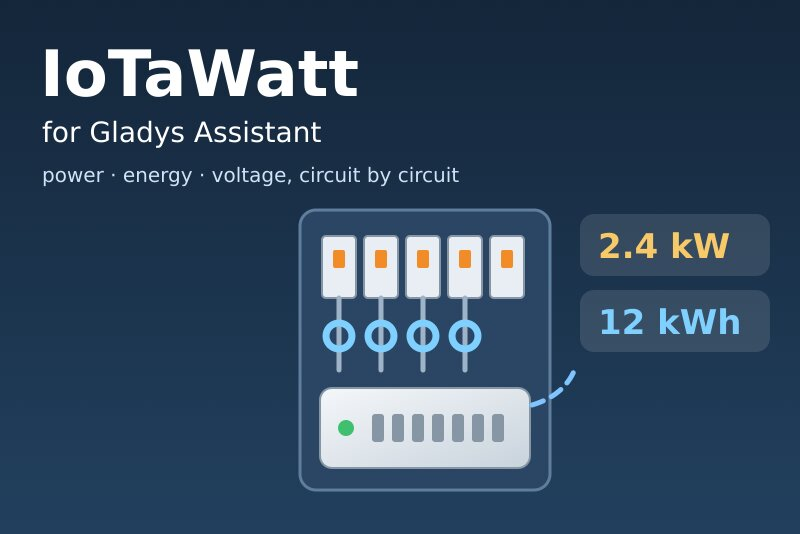
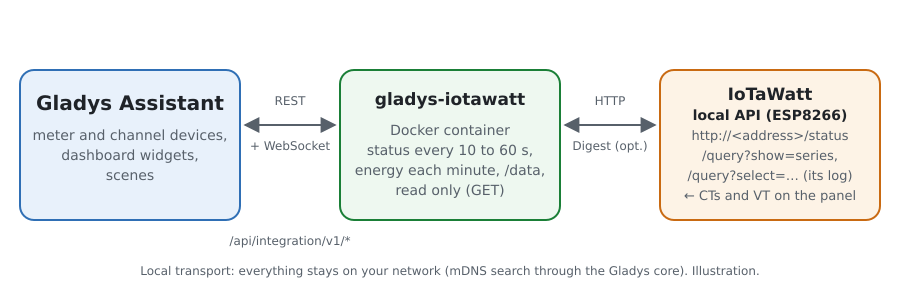
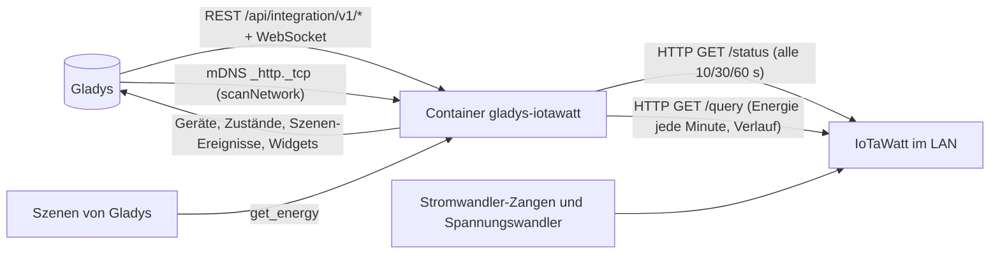
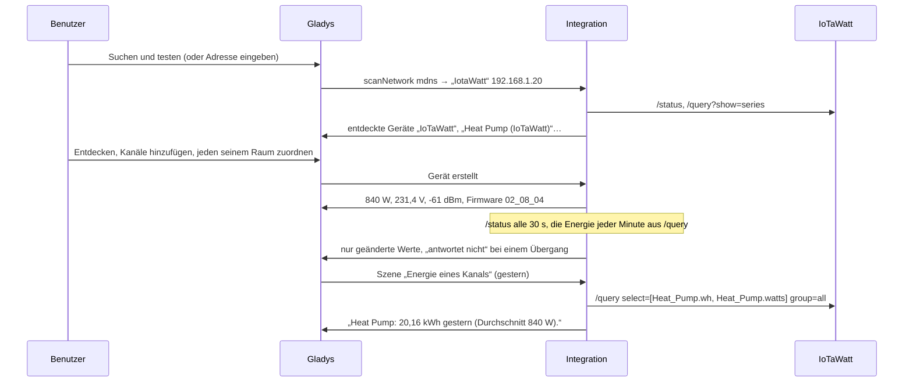
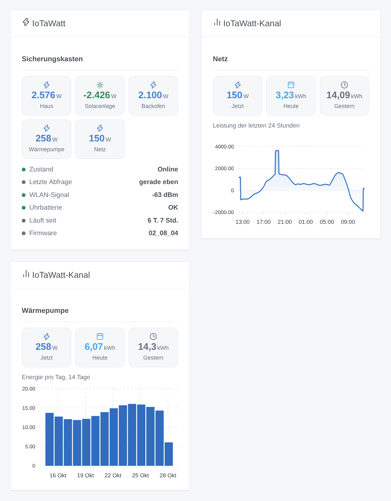

# Gladys IoTaWatt

[English](README.md) · [Français](README.fr.md) · **Deutsch** · [Español](README.es.md)

[](LICENSE)
[](https://github.com/William-De71/gladys-iotawatt/releases)
[](https://github.com/William-De71/gladys-iotawatt/actions/workflows/release.yml)
[](https://gladysassistant.com)



Externe Integration für [Gladys Assistant](https://gladysassistant.com) für **IoTaWatt**-Energiemonitore (offene Hardware: Stromwandler-Zangen an den Stromkreisen deines Sicherungskastens, ein Spannungswandler an einer Steckdose), über ihre dokumentierte lokale API. Sie zeigt in Gladys Leistung, verbrauchte und eingespeiste Energie, Spannung und Stromstärke jedes Stromkreises, zählt die Energie aus dem Protokoll des IoTaWatt selbst und löst Szenen aus, wenn ein IoTaWatt nicht mehr antwortet oder neu startet — nur lesend, in deinem lokalen Netzwerk.

Benutzerdokumentation: [English](docs/en.md) · [Français](docs/fr.md) · [Deutsch](docs/de.md) · [Español](docs/es.md).

Nicht mit IoTaWatt, Inc. verbunden. **Noch nicht mit einem echten IoTaWatt getestet**: Anfragen und Antworten folgen der offiziellen Dokumentation ([Abfrage-API](https://docs.iotawatt.com/en/master/query.html)) und den Quellen der Firmware 02_08_04, nur für die Fakten gelesen (kein Code übernommen, GPL-3.0).

## Funktionen

- Jeder **IoTaWatt** im Netzwerk: in der Konfiguration eingegebene Adressen oder per mDNS über den Gladys-Kern gefunden; an seiner MAC-Adresse erkannt, eine neue IP-Adresse wird also verfolgt.
- **Ein Gerät für den IoTaWatt** (WLAN-Signal, Uhrbatterie schwach, Firmware) und **ein Gerät pro Eingang oder Ausgang**: Leistung, verbrauchte Energie, eingespeiste Energie (sobald der Kanal negativ wird), Spannung, Stromstärke.
- **Energiezähler aus dem Protokoll des IoTaWatt**, jede Minute gezählt: Ein Neustart von Gladys oder des Containers verliert nichts (bis zu 7 Tage Nachholen).
- **3 Szenen-Auslöser** (antwortet nicht, antwortet wieder, neu gestartet), **1 Szenen-Aktion** (Energie eines Kanals über einen Zeitraum) und **2 Dashboard-Widgets** (ein IoTaWatt, ein Kanal mit einem Diagramm aus dem Protokoll).
- Leistung alle 10, 30 oder 60 Sekunden gelesen; eine Anfrage nach der anderen an den IoTaWatt (ein ESP8266).
- **Nur lesend**, optionales HTTP-Digest-Passwort (nie protokolliert, nie nach `/data` geschrieben).
- Überall vier Sprachen: Englisch, Französisch, Deutsch, Spanisch.

## Funktionsweise





Vom Netzwerk zur Szene:



### Transport

`transports: ["local"]`: Die Integration spricht per HTTP in deinem Netzwerk mit dem IoTaWatt; **keine Daten verlassen dein Zuhause**. Mit nur einem Kanal gibt es weder die Schaltfläche „Lokale Verbindung bevorzugen“ noch ein Transport-Abzeichen pro Gerät. Die automatische Suche läuft über den Gladys-Kern (der Container sieht kein mDNS), der `_http._tcp` durchsucht und der Integration die rohen Antworten gibt; nur Namen, die „iota“ enthalten, werden probiert. `/data/iotawatt.json` (Modus 0600) speichert pro IoTaWatt seine letzte Adresse, seine Kanäle und Werte, die Energiezähler und die erste noch nicht gezählte Minute sowie das, was die Auslöser wissen — nie das Passwort.

## Geräte und Funktionen

| Gerät                          | Funktionen (Kategorie / Typ)                                                                                                                                                                    |
| ------------------------------ | ----------------------------------------------------------------------------------------------------------------------------------------------------------------------------------------------- |
| Der IoTaWatt                   | WLAN-Signal (`signal` / `integer`, dBm ohne Einheit), Uhrbatterie schwach (`battery-low` / `binary`), Firmware (`text` / `text`)                                                                |
| Leistungseingang oder -ausgang | Leistung (`energy-sensor` / `power`, W, mit Vorzeichen), verbrauchte Energie (`energy-sensor` / `index`, kWh), eingespeiste Energie (`energy-production-sensor` / `index`, kWh, sobald negativ) |
| Spannungseingang/-ausgang      | Spannung (`energy-sensor` / `voltage`, V)                                                                                                                                                       |
| Stromausgang                   | Stromstärke (`energy-sensor` / `current`, A)                                                                                                                                                    |

- Die externen IDs beruhen auf der MAC-Adresse: `ext:…:meter:<mac>`, `ext:…:channel:<mac>-in<Kanal>` für einen Eingang (Umbenennen im IoTaWatt behält das Gerät), `ext:…:channel:<mac>-out-<Name>` für einen Ausgang (umbenannt ist es ein neues Gerät).
- Die Energiezähler beginnen bei 0, wenn die Integration einen Kanal zum ersten Mal sieht; Gladys nutzt nur ihre Zunahmen. Positive Minuten gehen in „verbrauchte Energie“, negative in „eingespeiste Energie“.
- „Eingespeiste Energie“ kommt hinzu, sobald ein Kanal negativ gesehen wurde (letzte 7 Tage bei der ersten Abfrage, oder später): Drücke im Bildschirm Entdecken auf **Aktualisieren**.
- Ausgänge in VA, VAR, PF oder Hz haben keine passende Funktion in Gladys und werden nicht angeboten.
- Alle Funktionen sind schreibgeschützt; die Zustände werden bei Änderung gesendet, sonst alle 30 Minuten; ein nicht erreichbarer IoTaWatt sendet nichts (Gladys zeigt seine Werte als veraltet).

## Szenen-Auslöser, Aktionen und Widgets



**Widgets**: IoTaWatt (ein IoTaWatt, standardmäßig der erste: die Leistung seiner fünf stärksten Kanäle, eingespeiste Leistung in Grün; sein Zustand, letzte Abfrage, WLAN-Signal, Uhrbatterie, Laufzeit und Firmware) und IoTaWatt-Kanal (ein Kanal: aktuelle Leistung, Energie von heute und gestern und ein Diagramm aus dem Protokoll des IoTaWatt: 24 Stunden Leistung, 14 Tage oder 12 Monate Energie; beim IoTaWatt abgefragt und 5 Minuten behalten).

**Auslöser** (ein Ereignis pro Übergang, nie bei der ersten Abfrage, nie als Folge einer Aktion; Filter: das IoTaWatt-Gerät):

- **antwortet nicht**: keine Antwort auf 3 Abfragen in Folge, mindestens eine Minute lang; Variablen: Name, Adresse, MAC-Adresse, verpasste Abfragen, Nachricht;
- **antwortet wieder**: Variable: Minuten ohne Antwort;
- **neu gestartet**: die Laufzeit ging zurück (Stromausfall, Update, Absturz); Variable: Laufzeit davor in Stunden.

Die Werte sind Gerätefunktionen: „Leistung über 3.000 W“ ist eine Gerätebedingung von Gladys, mit deinem eigenen Schwellwert.

**Aktion**:

- **Energie eines Kanals**: die Energie (kWh) und die Durchschnittsleistung (W) eines Leistungskanals über einen Zeitraum (heute, gestern, diese Woche, letzte Woche, dieser Monat, letzter Monat, dieses Jahr, letzte 24 Stunden, letzte 7 Tage, letzte 30 Tage), Beginn und Ende des Zeitraums und ein Satz (`summary`); vom IoTaWatt aus seinem Protokoll berechnet, in seiner Ortszeit.

Bewusst nicht enthalten: kein Schreiben auf den IoTaWatt (Konfiguration, Uploader), kein VA / VAR / PF / Hz, kein Import des Verlaufs in die Zähler.

Beispiele:

- Jeden Morgen um 8:00 → **IoTaWatt: Energie eines Kanals** (Heat Pump, gestern) → dessen `summary` senden.
- Wenn die **Leistung** des Backofens 3.000 W übersteigt (Gerätebedingung) → den Warmwasserbereiter ausschalten.
- Wenn **IoTaWatt: antwortet nicht** → „{{triggerEvent.data.meter_name}} antwortet nicht: Stromausfall?“ senden.

## Voraussetzungen

- Gladys Assistant **5.3.0** oder neuer (Widgets und Szenen der Integrationen, Katalog-Schlüsselwörter von Gladys 5.3): Ältere Instanzen können die Integration nicht installieren.
- Ein mit seiner Konfigurations-App eingerichteter **IoTaWatt** (benannte Eingänge, Ausgänge nach Wunsch), im selben Netzwerk wie Gladys.
- Seine Adresse oder ein Gerätename mit „iota“ für die automatische Suche.
- Ein Passwort nur, wenn im IoTaWatt eines gesetzt ist und der lokale Zugriff ohne Passwort nicht erlaubt ist (das Konto `user` genügt).

### Das Tempo des Geräts

Ein IoTaWatt ist ein ESP8266: Der Client sendet eine Anfrage nach der anderen, ohne Keep-alive, mit 10 Sekunden Zeitlimit und einer kurzen Pause zwischen zwei Anfragen. Jede Runde liest `/status` (alle 10, 30 oder 60 s), die Liste der Reihen alle 10 Minuten oder wenn sich die Eingänge ändern, und jede Minute die Energie der seit der letzten Zählung protokollierten Minuten (`/query`, Gruppen von einer Minute, höchstens 12 Stunden pro Anfrage, höchstens 7 Tage zurück). Der Widget-Verlauf (3 Anfragen) wird 5 Minuten behalten; die Szenen-Aktion sendet eine Anfrage. Eine Adresse, die kein IoTaWatt ist, wird 30 Minuten in Ruhe gelassen; die automatische Suche läuft beim Start, bei jeder Suche und alle 30 Minuten, solange ein IoTaWatt fehlt oder nicht antwortet.

## Installation

- **Aus dem Store**: Integrationen → IoTaWatt → Installieren.
- **Über die URL des Repositorys**: Integrationen → externe Integration → `https://github.com/William-De71/gladys-iotawatt`.
- **Entwicklermodus**: `npm start` mit den von Gladys gelieferten Variablen starten (siehe Entwicklung).

## Konfiguration

| Feld oder Schaltfläche       | Standard    | Bedeutung                                                                                                    |
| ---------------------------- | ----------- | ------------------------------------------------------------------------------------------------------------ |
| Adressen                     | leer        | IP-Adressen oder Namen, durch Kommas getrennt; leer: automatische Suche (mDNS, Namen mit „iota“)             |
| Benutzer                     | `user`      | `user` (nur lesen) oder `admin`; nur mit einem Passwort verwendet                                            |
| Passwort                     | —           | Nur wenn der IoTaWatt eines verlangt; ein Geheimnis, nie wieder angezeigt, nie protokolliert, nie in `/data` |
| Leistungsabfrage             | 30 s        | 10 s, 30 s oder 1 Min.; die Energie wird in jedem Fall jede Minute gezählt                                   |
| Sprache der Texte            | automatisch | Namen der Funktionen, Szenentexte und Fehler (automatisch: die Sprache des zuletzt angezeigten Widgets)      |
| Suchen und testen / Diagnose | —           | Findet und liest die IoTaWatt, bietet ihre Kanäle an; der Zustand in den Protokollen, ohne Passwort          |

## Verwendung

1. Richte den IoTaWatt mit seiner Konfigurations-App ein (benenne die Eingänge).
2. In Gladys (Integrationen → IoTaWatt → Konfiguration): Gib seine Adresse ein oder lass das Feld leer; drücke **Suchen und testen**.
3. **Entdecken**, dann den IoTaWatt und die gewünschten Kanäle als Geräte hinzufügen.
4. Füge die Widgets einem Dashboard hinzu und baue Szenen mit den Funktionen, den Auslösern und der Aktion.

## Entwicklung

```bash
npm install
npm test                       # node --test, ein falsches IoTaWatt-Netzwerk (Status, Reihen, Abfragen, Digest), nie das Netzwerk
npm run lint                   # ESLint
npm run format:check           # Prettier
npx github:GladysAssistant/integration-store . --skip-image-check
scripts/build-cover.sh         # cover.jpg aus docs/assets/cover.svg
docs/illustrations/render.sh   # docs/assets/widgets.<Sprache>.png
```

Lokal liest das SDK `GLADYS_HOST_API_URL`, `GLADYS_INTEGRATION_TOKEN` und `GLADYS_INTEGRATION_SELECTOR` (von Gladys im Entwicklermodus geliefert), und die Integration liest `TZ`. `DEBUG=gladys-integration-sdk` zeigt die SDK-Protokolle.

Die Tests decken den HTTP-Client ab (Digest wie von der Firmware geprüft, eine Anfrage nach der anderen, die Fehler, die kaputte Reihenliste), die Parser (die Zuordnung von Eingängen und Reihen), die Energiezählung (Fenster, Nachholen, Einspeisung), die Auslöser, die Suche, die Geräte (die vom Bildschirm Entdecken verlangten Felder, die Kategorie-/Typ-Paare des Kerns), die Widgets (`validateWidgetContent`), das Manifest, die vier Sprachen, das Release-Skript und die ganze Integration gegen das falsche Gladys des SDK und ein falsches IoTaWatt-Netzwerk. `test/structure.test.js` friert jeden Schlüssel ein, den Benutzer speichern.

## Release-Prozess


Jeder Merge auf `main` startet die CI und berechnet dann die Version aus den [Conventional Commits](https://www.conventionalcommits.org/de/) seit dem letzten Tag: `feat` → Minor, `fix` / `perf` → Patch, `!` oder `BREAKING CHANGE` → Major (vor 1.0.0 ein Minor); `docs`, `chore`, `ci`, `test`, `style`, `refactor`, `build` allein veröffentlichen nichts. Der Changelog-Abschnitt wird erzeugt, der Tag gepusht, das Multi-Architektur-Image gebaut, dann erhält `main` den Release-Commit, das GitHub Release wird erstellt und ein letzter Job prüft das öffentliche Image, den Store-Validator und das Topic.

- Der Titel des Pull Requests wird zum Squash-Commit und dann zur Changelog-Zeile: Schreibe ihn auf Englisch, für den Benutzer (`pr-title.yml` prüft ihn). Bearbeite `CHANGELOG.md` nie von Hand.
- 1.0.0 ist eine Entscheidung: Actions → Release → Run workflow mit `release-as: 1.0.0`. `dry-run` zeigt Version und Notizen, ohne zu veröffentlichen.
- **Geschützter Branch**: Das Release pusht seinen Commit mit `GITHUB_TOKEN` auf `main`. Das Ruleset `protect-main` (kein Löschen, kein Force-Push) lässt ihn durch; eine strengere Regel (Pull Request Pflicht, Status Checks) bräuchte GitHub Actions in der Bypass-Liste oder eine GitHub App.
- Mache nach dem ersten Release das Paket auf `ghcr.io` öffentlich (Package settings → Change visibility), sonst kann Gladys es nicht laden.

## Fehlerbehebung

Siehe [docs/de.md](docs/de.md#fehlerbehebung). Melde Probleme mit den Versionen von Gladys, der Integration und der IoTaWatt-Firmware, der Meldung von **Suchen und testen** und dem Ergebnis von **Diagnose** (in den Protokollen der Integration). Füge nie dein Passwort ein.

## Mitwirken

Issues und Pull Requests sind willkommen. Führe `npm run format:check && npm run lint && npm test` aus, bevor du einen Pull Request öffnest, und lass jede externe ID und jeden gespeicherten Schlüssel unverändert (siehe [CLAUDE.md](CLAUDE.md)).

## Sicherheit

Siehe [SECURITY.md](SECURITY.md): Melde Schwachstellen vertraulich. Das Passwort ist ein `secret`-Feld: nie protokolliert, nie nach `/data` geschrieben, nur zur Berechnung der HTTP-Digest-Antwort verwendet (das Passwort selbst geht nie über das Netzwerk). `/data/iotawatt.json` wird mit Modus 0600 geschrieben.

## Kommende Screenshots

Die Bilder oben sind Illustrationen, keine Screenshots. Echte Screenshots kommen nach `docs/assets/screenshots/` (PNG, 1280 × 800): `configuration.png`, `discovery.png` (der IoTaWatt und seine angebotenen Kanäle), `device.png` (ein Kanal mit seinen Funktionen), `scene-energy.png` (eine Szene mit der Aktion „Energie eines Kanals“), `dashboard.png` (die zwei Widgets mit einem echten IoTaWatt).

## Lizenz

[Apache-Lizenz 2.0](LICENSE) — siehe auch [NOTICE](NOTICE). IoTaWatt ist eine Marke ihres Inhabers. Danke an die Dokumentation und das SDK von Gladys sowie an das IoTaWatt-Projekt für seine öffentliche Dokumentation und die Quellen seiner Firmware (GPL-3.0, nur für die Fakten gelesen, kein Code verwendet).
