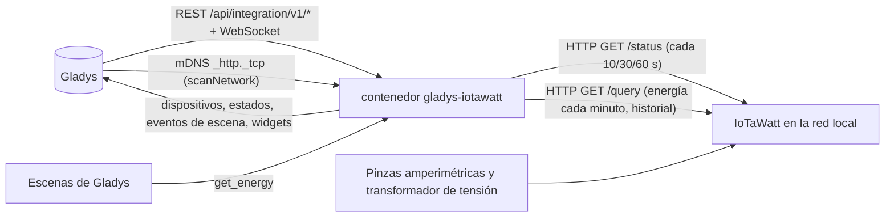
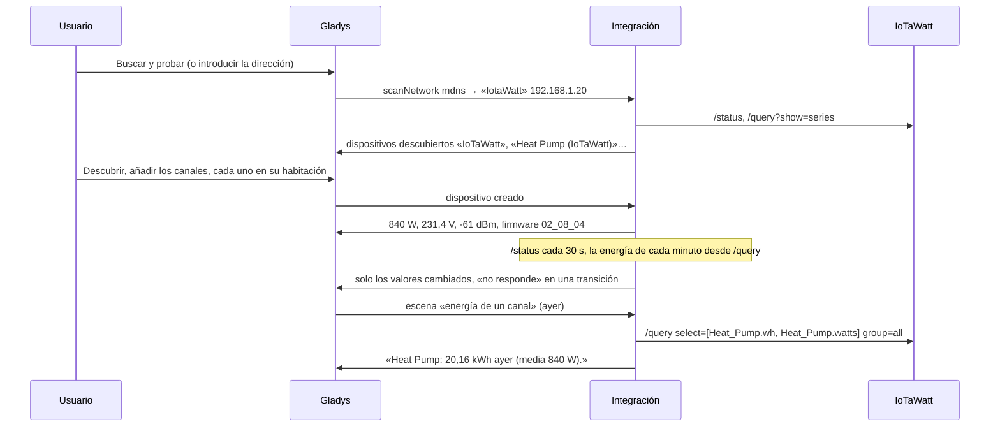
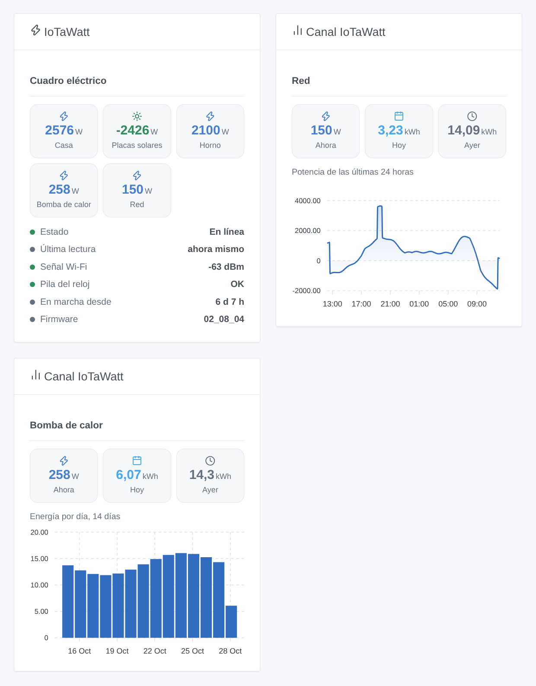

# Gladys IoTaWatt

[English](README.md) · [Français](README.fr.md) · [Deutsch](README.de.md) · **Español**

[](LICENSE)
[](https://github.com/William-De71/gladys-iotawatt/releases)
[](https://github.com/William-De71/gladys-iotawatt/actions/workflows/release.yml)
[](https://gladysassistant.com)


Integración externa de [Gladys Assistant](https://gladysassistant.com) para los monitores de energía **IoTaWatt** (hardware abierto: pinzas amperimétricas en los circuitos de su cuadro eléctrico, un transformador de tensión en un enchufe), mediante su API local documentada. Muestra en Gladys la potencia, la energía consumida y exportada, la tensión y la intensidad de cada circuito, cuenta la energía a partir del propio registro del IoTaWatt y dispara escenas cuando un IoTaWatt deja de responder o se reinicia — solo lectura, en su red local.

Documentación de usuario: [English](docs/en.md) · [Français](docs/fr.md) · [Deutsch](docs/de.md) · [Español](docs/es.md).

No afiliada a IoTaWatt, Inc. **Aún no probada con un IoTaWatt real**: las peticiones y respuestas siguen la documentación oficial ([API de consulta](https://docs.iotawatt.com/en/master/query.html)) y las fuentes del firmware 02_08_04, leídas solo para los hechos (ningún código copiado, GPL-3.0).

## Funciones

- Cada **IoTaWatt** de la red: direcciones introducidas en la configuración, o encontradas por mDNS a través del núcleo de Gladys; se reconoce por su dirección MAC, así que se sigue una nueva dirección IP.
- **Un dispositivo para el IoTaWatt** (señal Wi-Fi, pila del reloj baja, firmware) y **un dispositivo por entrada o salida**: potencia, energía consumida, energía exportada (en cuanto el canal pasa a negativo), tensión, intensidad.
- **Índices de energía del registro del IoTaWatt**, contados cada minuto: un reinicio de Gladys o del contenedor no pierde nada (hasta 7 días de puesta al día).
- **3 disparadores de escena** (no responde, vuelve a responder, reiniciado), **1 acción de escena** (energía de un canal en un periodo) y **2 widgets de panel** (un IoTaWatt, un canal con un gráfico del registro).
- Potencia leída cada 10, 30 o 60 segundos; una petición cada vez al IoTaWatt (un ESP8266).
- **Solo lectura**, contraseña HTTP Digest opcional (nunca en los registros, nunca escrita en `/data`).
- Cuatro idiomas en todo: inglés, francés, alemán, español.

## Funcionamiento




De la red a una escena:



### Transporte

`transports: ["local"]`: la integración habla con el IoTaWatt por HTTP en su red; **ningún dato sale de su casa**. Con un único canal, no hay botón «Preferir la conexión local» ni distintivo de transporte por dispositivo. La búsqueda automática pasa por el núcleo de Gladys (el contenedor no ve el mDNS), que explora `_http._tcp` y entrega las respuestas en bruto a la integración; solo se prueban los nombres que contienen «iota». `/data/iotawatt.json` (modo 0600) guarda, por IoTaWatt, su última dirección, sus canales y valores, los índices de energía y el primer minuto aún no contado, y lo que saben los disparadores — nunca la contraseña.

## Dispositivos y funciones

| Dispositivo                  | Funciones (categoría / tipo)                                                                                                                                                                  |
| ---------------------------- | --------------------------------------------------------------------------------------------------------------------------------------------------------------------------------------------- |
| El IoTaWatt                  | Señal Wi-Fi (`signal` / `integer`, dBm sin unidad), pila del reloj baja (`battery-low` / `binary`), firmware (`text` / `text`)                                                                |
| Entrada o salida de potencia | Potencia (`energy-sensor` / `power`, W, con signo), energía consumida (`energy-sensor` / `index`, kWh), energía exportada (`energy-production-sensor` / `index`, kWh, una vez vista negativa) |
| Entrada/salida de tensión    | Tensión (`energy-sensor` / `voltage`, V)                                                                                                                                                      |
| Salida de intensidad         | Intensidad (`energy-sensor` / `current`, A)                                                                                                                                                   |

- Los identificadores externos se basan en la dirección MAC: `ext:…:meter:<mac>`, `ext:…:channel:<mac>-in<canal>` para una entrada (renombrarla en el IoTaWatt conserva el dispositivo), `ext:…:channel:<mac>-out-<nombre>` para una salida (renombrada, es un dispositivo nuevo).
- Los índices de energía empiezan en 0 cuando la integración ve un canal por primera vez; Gladys solo usa sus aumentos. Los minutos positivos van a «energía consumida», los negativos a «energía exportada».
- «Energía exportada» se añade en cuanto un canal se ha visto negativo (últimos 7 días en la primera lectura, o más tarde): pulse **Actualizar** en la pantalla Descubrir.
- Las salidas en VA, VAR, PF o Hz no tienen función equivalente en Gladys y no se ofrecen.
- Todas las funciones son de solo lectura; los estados se envían cuando cambian, y si no cada 30 minutos; un IoTaWatt inaccesible no envía nada (Gladys muestra sus valores como desactualizados).

## Disparadores, acciones de escena y widgets



**Widgets**: IoTaWatt (un IoTaWatt, el primero por defecto: la potencia de sus cinco canales más cargados, la potencia exportada en verde; su estado, última lectura, señal Wi-Fi, pila del reloj, tiempo en marcha y firmware) y Canal IoTaWatt (un canal: potencia actual, energía de hoy y de ayer, y un gráfico del registro del IoTaWatt: 24 horas de potencia, 14 días o 12 meses de energía; pedido al IoTaWatt y guardado 5 minutos).

**Disparadores** (un evento por transición, nunca en la primera lectura, nunca como resultado de una acción; filtro: el dispositivo IoTaWatt):

- **no responde**: sin respuesta a 3 lecturas seguidas durante al menos un minuto; variables: nombre, dirección, dirección MAC, lecturas perdidas, mensaje;
- **vuelve a responder**: variable: minutos sin respuesta;
- **reiniciado**: el tiempo de funcionamiento retrocedió (corte de luz, actualización, bloqueo); variable: horas en marcha antes.

Los valores son funciones de dispositivo: «potencia por encima de 3000 W» es una condición de dispositivo de Gladys, con su propio umbral.

**Acción**:

- **energía de un canal**: la energía (kWh) y la potencia media (W) de un canal de potencia en un periodo (hoy, ayer, esta semana, la semana pasada, este mes, el mes pasado, este año, últimas 24 horas, últimos 7 días, últimos 30 días), el inicio y el fin del periodo y una frase (`summary`); calculada por el IoTaWatt a partir de su registro, en su hora local.

Deliberadamente ausente: ninguna escritura en el IoTaWatt (configuración, envíos a otros servicios), nada de VA / VAR / PF / Hz, ninguna importación del historial en los índices.

Ejemplos:

- Cada mañana a las 8:00 → **IoTaWatt: energía de un canal** (Heat Pump, ayer) → enviar su `summary`.
- Cuando la **Potencia** del horno supere 3000 W (condición de dispositivo) → apagar el calentador de agua.
- Cuando **IoTaWatt: no responde** → enviar «{{triggerEvent.data.meter_name}} no responde: ¿corte de luz?».

## Requisitos

- Gladys Assistant **5.3.0** o posterior (widgets y escenas de las integraciones, palabras clave del catálogo de Gladys 5.3): las instancias más antiguas no pueden instalar la integración.
- Un **IoTaWatt** configurado con su aplicación de configuración (entradas con nombre, salidas si las desea), en la misma red que Gladys.
- Su dirección, o un nombre de dispositivo que contenga «iota» para la búsqueda automática.
- Una contraseña solo si hay una en el IoTaWatt y no se permite el acceso local sin contraseña (la cuenta `user` basta).

### El ritmo del dispositivo

Un IoTaWatt es un ESP8266: el cliente envía una petición cada vez, sin keep-alive, con un tiempo límite de 10 segundos y una breve pausa entre dos peticiones. Cada ronda lee `/status` (cada 10, 30 o 60 s), la lista de series cada 10 minutos o cuando cambian las entradas, y cada minuto la energía de los minutos registrados desde el último recuento (`/query`, grupos de un minuto, como máximo 12 horas por petición, como máximo 7 días atrás). El historial de los widgets (3 peticiones) se guarda 5 minutos; la acción de escena envía una petición. Una dirección que no es un IoTaWatt se deja de lado 30 minutos; la búsqueda automática se hace al arrancar, en cada búsqueda y cada 30 minutos mientras falte un IoTaWatt o no responda.

## Instalación

- **Desde la tienda**: Integraciones → IoTaWatt → Instalar.
- **Desde la URL del repositorio**: Integraciones → integración externa → `https://github.com/William-De71/gladys-iotawatt`.
- **Modo desarrollador**: ejecute `npm start` con las variables que da Gladys (ver Desarrollo).

## Configuración

| Campo o botón                 | Por defecto | Función                                                                                                        |
| ----------------------------- | ----------- | -------------------------------------------------------------------------------------------------------------- |
| Direcciones                   | vacío       | Direcciones IP o nombres, separados por comas; vacío: búsqueda automática (mDNS, nombres que contienen «iota») |
| Usuario                       | `user`      | `user` (solo lectura) o `admin`; solo se usa con una contraseña                                                |
| Contraseña                    | —           | Solo si el IoTaWatt la pide; un secreto, nunca se vuelve a mostrar, nunca en los registros ni en `/data`       |
| Lectura de la potencia        | 30 s        | 10 s, 30 s o 1 min; la energía se cuenta cada minuto en todo caso                                              |
| Idioma de los textos          | automático  | Nombres de las funciones, textos de escenas y errores (automático: el idioma del último widget mostrado)       |
| Buscar y probar / Diagnóstico | —           | Encuentra y lee los IoTaWatt, ofrece sus canales; el estado en los registros, sin la contraseña                |

## Uso

1. Configure el IoTaWatt con su aplicación de configuración (ponga nombre a las entradas).
2. En Gladys (Integraciones → IoTaWatt → Configuración): introduzca su dirección, o déjela vacía; pulse **Buscar y probar**.
3. **Descubrir**, luego añada el IoTaWatt y los canales deseados como dispositivos.
4. Añada los widgets a un panel y cree escenas con las funciones, los disparadores y la acción.

## Desarrollo

```bash
npm install
npm test                       # node --test, una red IoTaWatt falsa (status, series, consultas, Digest), nunca la red
npm run lint                   # ESLint
npm run format:check           # Prettier
npx github:GladysAssistant/integration-store . --skip-image-check
scripts/build-cover.sh         # cover.jpg desde docs/assets/cover.svg
docs/illustrations/render.sh   # docs/assets/widgets.<idioma>.png
```

En local, el SDK lee `GLADYS_HOST_API_URL`, `GLADYS_INTEGRATION_TOKEN` y `GLADYS_INTEGRATION_SELECTOR` (que da Gladys en modo desarrollador), y la integración lee `TZ`. `DEBUG=gladys-integration-sdk` muestra los registros del SDK.

Las pruebas cubren el cliente HTTP (Digest comprobado como lo hace el firmware, una petición cada vez, los errores, la lista de series rota), los analizadores (el emparejamiento de entradas y series), el recuento de energía (ventanas, puesta al día, exportación), los disparadores, la búsqueda, los dispositivos (los campos que exige la pantalla Descubrir, los pares categoría / tipo del núcleo), los widgets (`validateWidgetContent`), el manifiesto, los cuatro idiomas, el script de release y toda la integración frente al Gladys falso del SDK y una red IoTaWatt falsa. `test/structure.test.js` congela cada clave que guardan los usuarios.

## Proceso de release


Cada fusión en `main` lanza la CI y luego calcula la versión a partir de los [Conventional Commits](https://www.conventionalcommits.org/es/) desde la última etiqueta: `feat` → menor, `fix` / `perf` → parche, `!` o `BREAKING CHANGE` → mayor (una menor antes de 1.0.0); `docs`, `chore`, `ci`, `test`, `style`, `refactor`, `build` solos no publican nada. Se genera la sección del changelog, se sube la etiqueta, se construye la imagen multiarquitectura, luego `main` recibe el commit de release, se crea la GitHub Release y un último job comprueba la imagen pública, el validador de la tienda y el topic.

- El título de la pull request se convierte en el commit squash y luego en la línea del changelog: escríbalo en inglés, para el usuario (`pr-title.yml` lo comprueba). No edite nunca `CHANGELOG.md` a mano.
- La 1.0.0 es una decisión: Actions → Release → Run workflow con `release-as: 1.0.0`. `dry-run` muestra la versión y las notas sin publicar.
- **Rama protegida**: la release sube su commit a `main` con `GITHUB_TOKEN`. El ruleset `protect-main` (sin borrado, sin force-push) lo deja pasar; una regla más estricta (pull request obligatoria, status checks) necesitaría GitHub Actions en su lista de excepciones, o una GitHub App.
- Tras la primera release, haga público el paquete de `ghcr.io` (Package settings → Change visibility), o Gladys no podrá descargarlo.

## Solución de problemas

Vea [docs/es.md](docs/es.md#solución-de-problemas). Informe de los problemas con las versiones de Gladys, de la integración y del firmware del IoTaWatt, el mensaje de **Buscar y probar** y el resultado de **Diagnóstico** (en los registros de la integración). No pegue nunca su contraseña.

## Contribuir

Las issues y pull requests son bienvenidas. Ejecute `npm run format:check && npm run lint && npm test` antes de abrir una pull request, y mantenga sin cambios todos los identificadores externos y claves guardadas (vea [CLAUDE.md](CLAUDE.md)).

## Seguridad

Vea [SECURITY.md](SECURITY.md): informe de las vulnerabilidades en privado. La contraseña es un campo `secret`: nunca en los registros, nunca escrita en `/data`, solo usada para calcular la respuesta HTTP Digest (la contraseña en sí nunca viaja por la red). `/data/iotawatt.json` se escribe con el modo 0600.

## Capturas pendientes

Las imágenes anteriores son ilustraciones, no capturas de pantalla. Las capturas reales irán en `docs/assets/screenshots/` (PNG, 1280 × 800): `configuration.png`, `discovery.png` (el IoTaWatt y sus canales ofrecidos), `device.png` (un canal con sus funciones), `scene-energy.png` (una escena con la acción «energía de un canal»), `dashboard.png` (los dos widgets con un IoTaWatt real).

## Licencia

[Licencia Apache 2.0](LICENSE) — vea también [NOTICE](NOTICE). IoTaWatt es una marca de su propietario. Gracias a la documentación y al SDK de Gladys, y al proyecto IoTaWatt por su documentación pública y las fuentes de su firmware (GPL-3.0, leídas solo para los hechos, ningún código usado).
