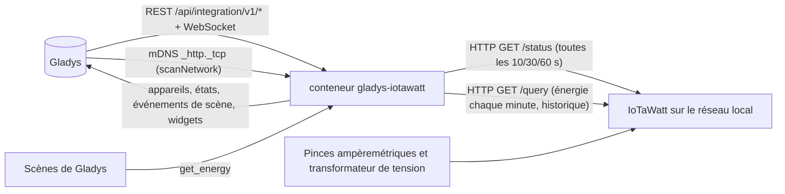
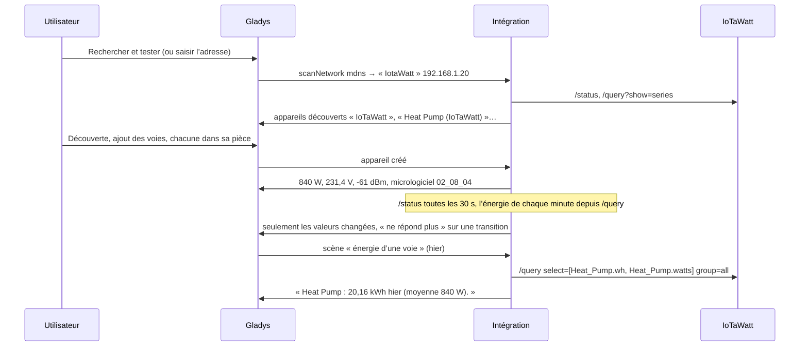
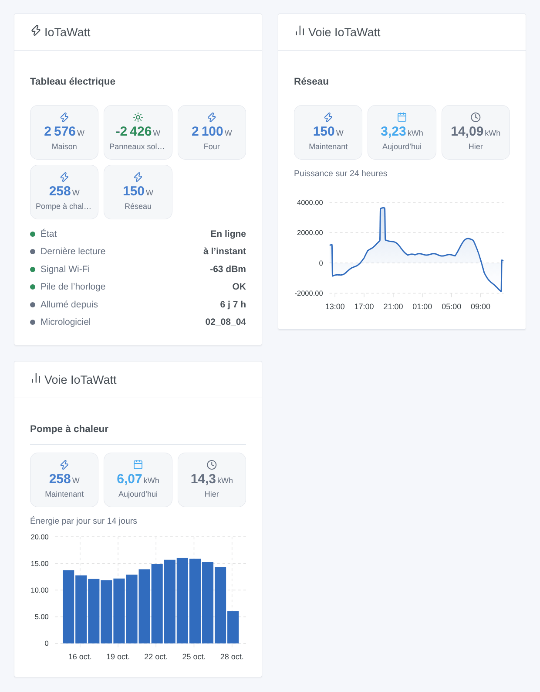

# Gladys IoTaWatt

[English](README.md) · **Français** · [Deutsch](README.de.md) · [Español](README.es.md)

[](LICENSE)
[](https://github.com/William-De71/gladys-iotawatt/releases)
[](https://github.com/William-De71/gladys-iotawatt/actions/workflows/release.yml)
[](https://gladysassistant.com)


Intégration externe de [Gladys Assistant](https://gladysassistant.com) pour les moniteurs d’énergie **IoTaWatt** (matériel libre : des pinces ampèremétriques sur les circuits de votre tableau électrique, un transformateur de tension sur une prise), par leur API locale documentée. Elle affiche dans Gladys la puissance, l’énergie consommée et injectée, la tension et l’intensité de chaque circuit, compte l’énergie à partir du journal de l’IoTaWatt lui-même, et déclenche des scènes quand un IoTaWatt ne répond plus ou redémarre — en lecture seule, sur votre réseau local.

Documentation utilisateur : [English](docs/en.md) · [Français](docs/fr.md) · [Deutsch](docs/de.md) · [Español](docs/es.md).

Non affiliée à IoTaWatt, Inc. **Pas encore testée avec un vrai IoTaWatt** : les requêtes et les réponses suivent la documentation officielle ([API de requête](https://docs.iotawatt.com/en/master/query.html)) et les sources du micrologiciel 02_08_04, lues pour les faits seulement (aucun code repris, GPL-3.0).

## Fonctionnalités

- Chaque **IoTaWatt** du réseau : adresses saisies dans la configuration, ou trouvées en mDNS par le cœur de Gladys ; reconnu par son adresse MAC, une nouvelle adresse IP est donc suivie.
- **Un appareil pour l’IoTaWatt** (signal Wi-Fi, pile de l’horloge faible, micrologiciel) et **un appareil par entrée ou sortie** : puissance, énergie consommée, énergie injectée (dès que la voie devient négative), tension, intensité.
- **Index d’énergie tirés du journal de l’IoTaWatt**, comptés chaque minute : un redémarrage de Gladys ou du conteneur ne perd rien (jusqu’à 7 jours de rattrapage).
- **3 déclencheurs de scène** (ne répond plus, répond de nouveau, redémarré), **1 action de scène** (énergie d’une voie sur une période) et **2 widgets** (un IoTaWatt, une voie avec un graphique tiré du journal).
- Puissance lue toutes les 10, 30 ou 60 secondes ; une requête à la fois vers l’IoTaWatt (un ESP8266).
- **Lecture seule**, mot de passe HTTP Digest facultatif (jamais dans les journaux, jamais écrit dans `/data`).
- Quatre langues partout : anglais, français, allemand, espagnol.

## Fonctionnement




Du réseau à une scène :



### Transport

`transports: ["local"]` : l’intégration parle à l’IoTaWatt en HTTP sur votre réseau ; **aucune donnée ne sort de chez vous**. Avec un seul canal, il n’y a ni bouton « Préférer la connexion locale » ni badge de transport par appareil. La recherche automatique passe par le cœur de Gladys (le conteneur ne voit pas le mDNS), qui parcourt `_http._tcp` et donne les réponses brutes à l’intégration ; seuls les noms qui contiennent « iota » sont essayés. `/data/iotawatt.json` (mode 0600) garde, par IoTaWatt, sa dernière adresse, ses voies et leurs valeurs, les index d’énergie et la première minute pas encore comptée, et ce que savent les déclencheurs — jamais le mot de passe.

## Appareils et fonctionnalités

| Appareil                      | Fonctionnalités (catégorie / type)                                                                                                                                                        |
| ----------------------------- | ----------------------------------------------------------------------------------------------------------------------------------------------------------------------------------------- |
| L’IoTaWatt                    | Signal Wi-Fi (`signal` / `integer`, dBm sans unité), pile de l’horloge faible (`battery-low` / `binary`), micrologiciel (`text` / `text`)                                                 |
| Entrée ou sortie de puissance | Puissance (`energy-sensor` / `power`, W, signée), énergie consommée (`energy-sensor` / `index`, kWh), énergie injectée (`energy-production-sensor` / `index`, kWh, une fois vue négative) |
| Entrée/sortie de tension      | Tension (`energy-sensor` / `voltage`, V)                                                                                                                                                  |
| Sortie d’intensité            | Intensité (`energy-sensor` / `current`, A)                                                                                                                                                |

- Les identifiants externes reposent sur l’adresse MAC : `ext:…:meter:<mac>`, `ext:…:channel:<mac>-in<voie>` pour une entrée (la renommer dans l’IoTaWatt garde l’appareil), `ext:…:channel:<mac>-out-<nom>` pour une sortie (renommée, c’est un nouvel appareil).
- Les index d’énergie partent de 0 quand l’intégration voit une voie pour la première fois ; Gladys n’utilise que leurs augmentations. Les minutes positives vont dans « énergie consommée », les négatives dans « énergie injectée ».
- « Énergie injectée » est ajoutée dès qu’une voie a été vue négative (7 derniers jours à la première lecture, ou plus tard) : appuyez sur **Mettre à jour** dans l’écran Découverte.
- Les sorties en VA, VAR, PF ou Hz n’ont pas de fonctionnalité correspondante dans Gladys et ne sont pas proposées.
- Toutes les fonctionnalités sont en lecture seule ; les états sont envoyés quand ils changent, et toutes les 30 minutes sinon ; un IoTaWatt injoignable n’envoie rien (Gladys affiche ses valeurs comme anciennes).

## Déclencheurs, actions de scène et widgets



**Widgets** : IoTaWatt (un IoTaWatt, le premier par défaut : la puissance de ses cinq voies les plus chargées, la puissance injectée en vert ; son état, la dernière lecture, le signal Wi-Fi, la pile de l’horloge, la durée de fonctionnement et le micrologiciel) et Voie IoTaWatt (une voie : puissance actuelle, énergie d’aujourd’hui et d’hier, et un graphique tiré du journal de l’IoTaWatt : 24 heures de puissance, 14 jours ou 12 mois d’énergie ; demandé à l’IoTaWatt et gardé 5 minutes).

**Déclencheurs** (un événement par transition, jamais à la première lecture, jamais à la suite d’une action ; filtre : l’appareil IoTaWatt) :

- **ne répond plus** : pas de réponse à 3 lectures de suite pendant au moins une minute ; variables : nom, adresse, adresse MAC, lectures manquées, message ;
- **répond de nouveau** : variable : minutes sans réponse ;
- **redémarré** : la durée de fonctionnement est revenue en arrière (coupure de courant, mise à jour, plantage) ; variable : heures de marche avant.

Les valeurs sont des fonctionnalités d’appareil : « puissance au-dessus de 3 000 W » est une condition d’appareil de Gladys, avec votre propre seuil.

**Action** :

- **énergie d’une voie** : l’énergie (kWh) et la puissance moyenne (W) d’une voie de puissance sur une période (aujourd’hui, hier, cette semaine, la semaine dernière, ce mois-ci, le mois dernier, cette année, dernières 24 heures, 7 derniers jours, 30 derniers jours), le début et la fin de la période et une phrase (`summary`) ; calculée par l’IoTaWatt à partir de son journal, à son heure locale.

Volontairement absent : aucune écriture dans l’IoTaWatt (configuration, envois vers d’autres services), pas de VA / VAR / PF / Hz, pas d’import de l’historique dans les index.

Exemples :

- Chaque matin à 8 h → **IoTaWatt : énergie d’une voie** (Heat Pump, hier) → envoyer son `summary`.
- Quand la **Puissance** du four dépasse 3 000 W (condition d’appareil) → éteindre le chauffe-eau.
- Quand **IoTaWatt : ne répond plus** → envoyer « {{triggerEvent.data.meter_name}} ne répond plus : coupure de courant ? ».

## Prérequis

- Gladys Assistant **5.3.0** ou plus récent (widgets et scènes des intégrations, mots-clés du catalogue de Gladys 5.3) : les instances plus anciennes ne peuvent pas installer l’intégration.
- Un **IoTaWatt** configuré avec son application de configuration (entrées nommées, sorties si besoin), sur le même réseau que Gladys.
- Son adresse, ou un nom d’appareil contenant « iota » pour la recherche automatique.
- Un mot de passe seulement s’il en existe un dans l’IoTaWatt et que l’accès local sans mot de passe n’est pas autorisé (le compte `user` suffit).

### Le rythme de l’appareil

Un IoTaWatt est un ESP8266 : le client envoie une requête à la fois, sans keep-alive, avec un délai de 10 secondes et une courte pause entre deux requêtes. Chaque tour lit `/status` (toutes les 10, 30 ou 60 s), la liste des séries toutes les 10 minutes ou quand les entrées changent, et chaque minute l’énergie des minutes enregistrées depuis le dernier comptage (`/query`, groupes d’une minute, 12 heures au plus par requête, 7 jours au plus en arrière). L’historique des widgets (3 requêtes) est gardé 5 minutes ; l’action de scène envoie une requête. Une adresse qui n’est pas un IoTaWatt est laissée de côté 30 minutes ; la recherche automatique a lieu au démarrage, à chaque recherche, et toutes les 30 minutes tant qu’un IoTaWatt manque ou ne répond pas.

## Installation

- **Depuis le store** : Intégrations → IoTaWatt → Installer.
- **Depuis l’URL du dépôt** : Intégrations → intégration externe → `https://github.com/William-De71/gladys-iotawatt`.
- **Mode développeur** : lancez `npm start` avec les variables fournies par Gladys (voir Développement).

## Configuration

| Champ ou bouton                   | Défaut      | Rôle                                                                                                         |
| --------------------------------- | ----------- | ------------------------------------------------------------------------------------------------------------ |
| Adresses                          | vide        | Adresses IP ou noms, séparés par des virgules ; vide : recherche automatique (mDNS, noms contenant « iota ») |
| Utilisateur                       | `user`      | `user` (lecture seule) ou `admin` ; utilisé seulement avec un mot de passe                                   |
| Mot de passe                      | —           | Seulement si l’IoTaWatt en demande un ; un secret, jamais réaffiché, jamais journalisé, jamais dans `/data`  |
| Lecture de la puissance           | 30 s        | 10 s, 30 s ou 1 min ; l’énergie est comptée chaque minute dans tous les cas                                  |
| Langue des textes                 | automatique | Noms des fonctionnalités, textes des scènes et erreurs (automatique : la langue du dernier widget affiché)   |
| Rechercher et tester / Diagnostic | —           | Trouve et lit les IoTaWatt, propose leurs voies ; l’état dans les journaux, sans le mot de passe             |

## Utilisation

1. Configurez l’IoTaWatt avec son application de configuration (nommez les entrées).
2. Dans Gladys (Intégrations → IoTaWatt → Configuration) : saisissez son adresse, ou laissez vide ; appuyez sur **Rechercher et tester**.
3. **Découverte**, puis ajoutez l’IoTaWatt et les voies voulues comme appareils.
4. Ajoutez les widgets à un tableau de bord, construisez des scènes avec les fonctionnalités, les déclencheurs et l’action.

## Développement

```bash
npm install
npm test                       # node --test, un faux réseau IoTaWatt (status, séries, requêtes, Digest), jamais le réseau
npm run lint                   # ESLint
npm run format:check           # Prettier
npx github:GladysAssistant/integration-store . --skip-image-check
scripts/build-cover.sh         # cover.jpg depuis docs/assets/cover.svg
docs/illustrations/render.sh   # docs/assets/widgets.<langue>.png
```

En local, le SDK lit `GLADYS_HOST_API_URL`, `GLADYS_INTEGRATION_TOKEN` et `GLADYS_INTEGRATION_SELECTOR` (fournies par Gladys en mode développeur), et l’intégration lit `TZ`. `DEBUG=gladys-integration-sdk` affiche les journaux du SDK.

Les tests couvrent le client HTTP (Digest vérifié comme le fait le micrologiciel, une requête à la fois, les erreurs, la liste de séries cassée), les analyseurs (l’appariement des entrées et des séries), le comptage de l’énergie (fenêtres, rattrapage, injection), les déclencheurs, la découverte, les appareils (les champs exigés par l’écran Découverte, les couples catégorie / type du cœur), les widgets (`validateWidgetContent`), le manifeste, les quatre langues, le script de release, et toute l’intégration face au faux Gladys du SDK et à un faux réseau IoTaWatt. `test/structure.test.js` fige chaque clé que les utilisateurs enregistrent.

## Processus de release


Chaque fusion sur `main` lance la CI, puis calcule la version à partir des [Conventional Commits](https://www.conventionalcommits.org/fr/) depuis le dernier tag : `feat` → mineure, `fix` / `perf` → corrective, `!` ou `BREAKING CHANGE` → majeure (une mineure avant 1.0.0) ; `docs`, `chore`, `ci`, `test`, `style`, `refactor`, `build` seuls ne publient rien. La section du changelog est générée, le tag poussé, l’image multi-architecture construite, puis `main` reçoit le commit de release, la GitHub Release est créée et un dernier job vérifie l’image publique, le validateur du store et le topic.

- Le titre de la pull request devient le commit squash, puis la ligne du changelog : écrivez-le en anglais, pour l’utilisateur (`pr-title.yml` le vérifie). N’éditez jamais `CHANGELOG.md` à la main.
- La 1.0.0 est une décision : Actions → Release → Run workflow avec `release-as: 1.0.0`. `dry-run` affiche la version et les notes sans rien publier.
- **Branche protégée** : la release pousse son commit sur `main` avec `GITHUB_TOKEN`. Le ruleset `protect-main` (pas de suppression, pas de force-push) le laisse passer ; une règle plus stricte (pull request obligatoire, status checks) demanderait GitHub Actions dans la liste de contournement, ou une GitHub App.
- Après la première release, rendez public le package `ghcr.io` (Package settings → Change visibility), sinon Gladys ne peut pas le télécharger.

## Dépannage

Voir [docs/fr.md](docs/fr.md#dépannage). Signalez les problèmes avec les versions de Gladys, de l’intégration et du micrologiciel de l’IoTaWatt, le message de **Rechercher et tester** et le résultat de **Diagnostic** (dans les journaux de l’intégration). Ne collez jamais votre mot de passe.

## Contribuer

Issues et pull requests bienvenues. Lancez `npm run format:check && npm run lint && npm test` avant d’ouvrir une pull request, et gardez inchangés tous les identifiants externes et clés enregistrées (voir [CLAUDE.md](CLAUDE.md)).

## Sécurité

Voir [SECURITY.md](SECURITY.md) : signalez les vulnérabilités en privé. Le mot de passe est un champ `secret` : jamais journalisé, jamais écrit dans `/data`, seulement utilisé pour calculer la réponse HTTP Digest (le mot de passe lui-même ne circule jamais sur le réseau). `/data/iotawatt.json` est écrit avec le mode 0600.

## Captures à venir

Les images ci-dessus sont des illustrations, pas des captures d’écran. Les vraies captures iront dans `docs/assets/screenshots/` (PNG, 1280 × 800) : `configuration.png`, `discovery.png` (l’IoTaWatt et ses voies proposés), `device.png` (une voie avec ses fonctionnalités), `scene-energy.png` (une scène avec l’action « énergie d’une voie »), `dashboard.png` (les deux widgets avec un vrai IoTaWatt).

## Licence

[Licence Apache 2.0](LICENSE) — voir aussi [NOTICE](NOTICE). IoTaWatt est une marque de son propriétaire. Merci à la documentation et au SDK de Gladys, et au projet IoTaWatt pour sa documentation publique et les sources de son micrologiciel (GPL-3.0, lues pour les faits seulement, aucun code utilisé).
