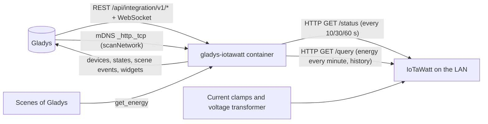
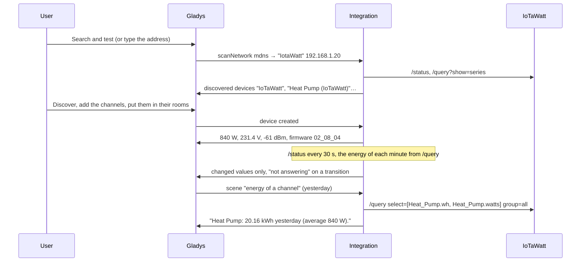
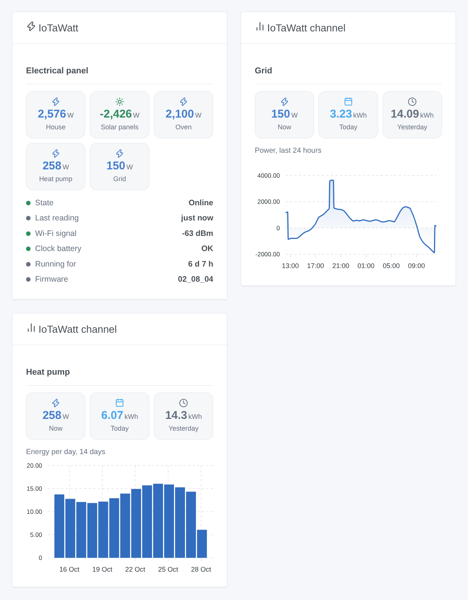

# Gladys IoTaWatt

**English** · [Français](README.fr.md) · [Deutsch](README.de.md) · [Español](README.es.md)

[](LICENSE)
[](https://github.com/William-De71/gladys-iotawatt/releases)
[](https://github.com/William-De71/gladys-iotawatt/actions/workflows/release.yml)
[](https://gladysassistant.com)


[Gladys Assistant](https://gladysassistant.com) external integration for **IoTaWatt** energy monitors (open hardware: current clamps on the circuits of your electrical panel, a voltage transformer on a socket), through their documented local API. It shows the power, the energy consumed and exported, the voltage and the current of each circuit in Gladys, counts the energy from the IoTaWatt's own log, and fires scenes when an IoTaWatt stops answering or restarts — read only, on your local network.

User documentation: [English](docs/en.md) · [Français](docs/fr.md) · [Deutsch](docs/de.md) · [Español](docs/es.md).

Not affiliated with IoTaWatt, Inc. **Not tested with a real IoTaWatt yet**: the requests and answers follow the official documentation ([query API](https://docs.iotawatt.com/en/master/query.html)) and the sources of the firmware 02_08_04, read for the facts only (no code taken from them, GPL-3.0).

## Features

- Every **IoTaWatt** of the network: addresses typed in the configuration, or found with mDNS through the Gladys core; known by its MAC address, so a new IP address is followed.
- **One device for the IoTaWatt** (Wi-Fi signal, low clock battery, firmware) and **one device per input or output**: power, energy consumed, energy exported (once the channel goes negative), voltage, current.
- **Energy indexes from the IoTaWatt's log**, counted every minute: a restart of Gladys or of the container loses nothing (up to 7 days of catch-up).
- **3 scene triggers** (not answering, answering again, restarted), **1 scene action** (energy of a channel over a period) and **2 dashboard widgets** (one IoTaWatt, one channel with a chart from the log).
- Power read every 10, 30 or 60 seconds; one request at a time to the IoTaWatt (an ESP8266).
- **Read only**, optional HTTP Digest password (never logged, never written to `/data`).
- Four languages everywhere: English, French, German, Spanish.

## How it works




From the network to a scene:



### Transport

`transports: ["local"]`: the integration talks to the IoTaWatt over HTTP on your network; **no data leaves your home**. With a single channel, there is no "prefer local connection" button nor per-device transport badge. The automatic search goes through the Gladys core (the container cannot see mDNS), which browses `_http._tcp` and gives the integration the raw answers; only the names that contain "iota" are tried. `/data/iotawatt.json` (mode 0600) keeps, per IoTaWatt, its last address, its channels and values, the energy indexes and the first minute not counted yet, and what the triggers know — never the password.

## Devices and features

| Device                | Features (category / type)                                                                                                                                                      |
| --------------------- | ------------------------------------------------------------------------------------------------------------------------------------------------------------------------------- |
| The IoTaWatt          | Wi-Fi signal (`signal` / `integer`, dBm without unit), clock battery low (`battery-low` / `binary`), firmware (`text` / `text`)                                                 |
| Power input or output | Power (`energy-sensor` / `power`, W, signed), energy consumed (`energy-sensor` / `index`, kWh), energy exported (`energy-production-sensor` / `index`, kWh, once seen negative) |
| Voltage input/output  | Voltage (`energy-sensor` / `voltage`, V)                                                                                                                                        |
| Current output        | Current (`energy-sensor` / `current`, A)                                                                                                                                        |

- External ids rest on the MAC address: `ext:…:meter:<mac>`, `ext:…:channel:<mac>-in<channel>` for an input (renaming it in the IoTaWatt keeps the device), `ext:…:channel:<mac>-out-<name>` for an output (renamed, it is a new device).
- The energy indexes start at 0 when the integration first sees a channel; Gladys only uses their increases. Positive minutes go to "energy consumed", negative ones to "energy exported".
- "Energy exported" is added once a channel was seen negative (last 7 days at the first reading, or later): press **Update** on the Discover screen.
- Outputs in VA, VAR, PF or Hz have no matching feature in Gladys and are not offered.
- Every feature is read only; the states are sent when they change, and every 30 minutes otherwise; an unreachable IoTaWatt sends nothing (Gladys shows its values outdated).

## Scene triggers, actions and widgets



**Widgets**: IoTaWatt (one IoTaWatt, the first one by default: the power of its five busiest channels, exported power in green; its state, last reading, Wi-Fi signal, clock battery, uptime and firmware) and IoTaWatt channel (one channel: power now, energy of today and yesterday, and a chart from the IoTaWatt's log: 24 hours of power, 14 days or 12 months of energy; asked to the IoTaWatt and kept 5 minutes).

**Triggers** (one event per transition, never at the first reading, never as the result of an action; filter: the IoTaWatt device):

- **not answering**: no answer to 3 readings in a row for at least a minute; variables: name, address, MAC address, readings missed, message;
- **answering again**: variable: minutes without answer;
- **restarted**: the uptime went back (power cut, update, crash); variable: hours running before.

The values are device features: "power above 3,000 W" is a device condition of Gladys, with your own threshold.

**Action**:

- **energy of a channel**: the energy (kWh) and the average power (W) of a power channel over a period (today, yesterday, this week, last week, this month, last month, this year, last 24 hours, last 7 days, last 30 days), the start and end of the period and a sentence (`summary`); computed by the IoTaWatt from its log, in its local time.

Not done, on purpose: no write to the IoTaWatt (configuration, uploaders), no VA / VAR / PF / Hz, no history import into the indexes.

Examples:

- Every morning at 8:00 → **IoTaWatt: energy of a channel** (Heat Pump, yesterday) → send its `summary`.
- When the **Power** of the oven goes above 3,000 W (device condition) → turn off the water heater.
- When **IoTaWatt: not answering** → send "{{triggerEvent.data.meter_name}} does not answer: power cut?".

## Requirements

- Gladys Assistant **5.3.0** or later (widgets and scenes of integrations, catalog keywords of Gladys 5.3): older instances cannot install the integration.
- An **IoTaWatt** set up with its configuration app (named inputs, outputs if wanted), on the same network as Gladys.
- Its address, or a device name containing "iota" for the automatic search.
- A password only if one is set in the IoTaWatt and local access without password is not allowed (the `user` account is enough).

### The pace of the device

An IoTaWatt is an ESP8266: the client sends one request at a time, without keep-alive, with a 10-second timeout and a short pause between requests. Each round reads `/status` (every 10, 30 or 60 s), the list of series every 10 minutes or when the inputs change, and once a minute the energy of the minutes logged since the last count (`/query`, 1-minute groups, at most 12 hours per request, at most 7 days back). The widget history (3 requests) is kept 5 minutes; the scene action sends one request. A non-IoTaWatt address is left alone 30 minutes; the automatic search runs at startup, on a scan, and every 30 minutes while an IoTaWatt is missing or unreachable.

## Installation

- **From the store**: Integrations → IoTaWatt → Install.
- **From the repository URL**: Integrations → external integration → `https://github.com/William-De71/gladys-iotawatt`.
- **Developer mode**: run `npm start` with the variables given by Gladys (see Development).

## Configuration

| Field or button              | Default   | Meaning                                                                                                  |
| ---------------------------- | --------- | -------------------------------------------------------------------------------------------------------- |
| Addresses                    | empty     | IP addresses or names, separated by commas; empty: automatic search (mDNS, names containing "iota")      |
| User                         | `user`    | `user` (read only) or `admin`; only used with a password                                                 |
| Password                     | —         | Only if the IoTaWatt asks for one; a secret, never shown again, never logged, never written to `/data`   |
| Power reading                | 30 s      | 10 s, 30 s or 1 min; the energy is counted every minute anyway                                           |
| Language of the texts        | automatic | Feature names, scene texts and errors (automatic: the language of the last widget shown)                 |
| Search and test / Diagnostic | —         | Finds and reads the IoTaWatt devices, offers their channels; the state in the logs, without the password |

## Usage

1. Set up the IoTaWatt with its configuration app (name the inputs).
2. In Gladys (Integrations → IoTaWatt → Configuration): type its address, or leave it empty; press **Search and test**.
3. **Discover**, then add the IoTaWatt and the channels you want as devices.
4. Add the widgets to a dashboard, build scenes with the features, the triggers and the action.

## Development

```bash
npm install
npm test                       # node --test, a fake IoTaWatt network (status, series, queries, Digest), never the network
npm run lint                   # ESLint
npm run format:check           # Prettier
npx github:GladysAssistant/integration-store . --skip-image-check
scripts/build-cover.sh         # cover.jpg from docs/assets/cover.svg
docs/illustrations/render.sh   # docs/assets/widgets.<lang>.png
```

Locally, the SDK reads `GLADYS_HOST_API_URL`, `GLADYS_INTEGRATION_TOKEN` and `GLADYS_INTEGRATION_SELECTOR` (given by Gladys in developer mode), and the integration reads `TZ`. `DEBUG=gladys-integration-sdk` shows the SDK logs.

The tests cover the HTTP client (Digest checked like the firmware, one request at a time, the errors, the broken series list), the parsers (the pairing of inputs and series), the energy counting (windows, catch-up, export), the triggers, the discovery, the devices (the fields the Discovery screen requires, the category / type pairs of the core), the widgets (`validateWidgetContent`), the manifest, the four languages, the release script, and the whole integration against the fake Gladys of the SDK and a fake IoTaWatt network. `test/structure.test.js` freezes every key users store.

## Release process


Every merge on `main` runs the CI, then computes the version from the [Conventional Commits](https://www.conventionalcommits.org/) since the last tag: `feat` → minor, `fix` / `perf` → patch, `!` or `BREAKING CHANGE` → major (a minor below 1.0.0); `docs`, `chore`, `ci`, `test`, `style`, `refactor`, `build` alone publish nothing. The changelog section is generated, the tag pushed, the multi-architecture image built, then `main` receives the release commit, the GitHub Release is created and a last job checks the public image, the store validator and the topic.

- The pull request title becomes the squash commit, then the changelog line: write it in English, for the user (`pr-title.yml` checks it). Never edit `CHANGELOG.md` by hand.
- 1.0.0 is a decision: Actions → Release → Run workflow with `release-as: 1.0.0`. `dry-run` shows the version and the notes without publishing.
- **Protected branch**: the release pushes its commit to `main` with `GITHUB_TOKEN`. The `protect-main` ruleset (no deletion, no force-push) lets it through; a stricter rule (pull request required, status checks) would need GitHub Actions in its bypass list, or a GitHub App.
- After the first release, make the `ghcr.io` package public (Package settings → Change visibility), or Gladys cannot pull it.

## Troubleshooting

See [docs/en.md](docs/en.md#troubleshooting). Report issues with the versions of Gladys, of the integration and of the IoTaWatt firmware, the message of **Search and test** and the result of **Diagnostic** (in the logs of the integration). Never paste your password.

## Contributing

Issues and pull requests are welcome. Run `npm run format:check && npm run lint && npm test` before opening a pull request, and keep every external id and stored key unchanged (see [CLAUDE.md](CLAUDE.md)).

## Security

See [SECURITY.md](SECURITY.md): report vulnerabilities privately. The password is a `secret` field: never logged, never written to `/data`, only used to compute the HTTP Digest answer (the password itself never travels on the network). `/data/iotawatt.json` is written with mode 0600.

## Screenshots to come

The images above are illustrations, not screenshots. Real screenshots will go in `docs/assets/screenshots/` (PNG, 1280 × 800): `configuration.png`, `discovery.png` (the IoTaWatt and its channels offered), `device.png` (a channel with its features), `scene-energy.png` (a scene with the "energy of a channel" action), `dashboard.png` (the two widgets with a real IoTaWatt).

## License

[Apache License 2.0](LICENSE) — see also [NOTICE](NOTICE). IoTaWatt is a trademark of its owner. Thanks to the Gladys documentation and SDK, and to the IoTaWatt project for its public documentation and firmware sources (GPL-3.0, read for the facts only, no code used).
